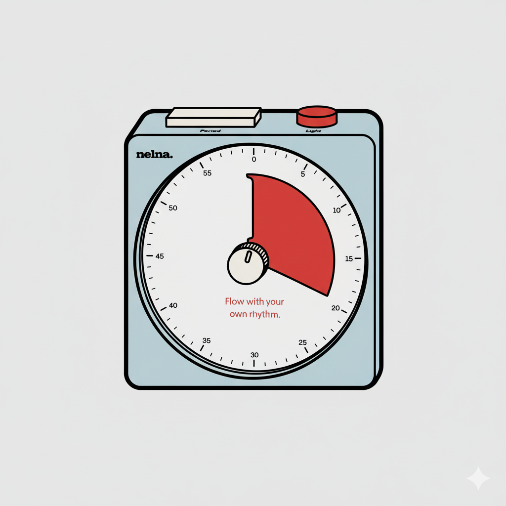

# SwissPomodoro

A small Pomodoro timer for macOS 14+, drawn as a Swiss kitchen timer: the red
sector is the time that has passed, and the lamp shows when a session is running.



## Features

- Analog dial plus digital remaining time; Start/Pause/Resume with the space bar.
- Presets (15/25/45/60) and custom session lengths, remembered between launches.
- Completion feedback: red time, sound, dock bounce and a system notification,
  including when the window is closed.
- Menu bar countdown with start/pause, plus window title and dock badge.
- Settings window (⌘,) for the default session length and completion sound.
- Accessibility labels, VoiceOver announcements, Reduce Motion support.

## Requirements

- macOS 14 or later
- Xcode 16.1 or later (Swift 6.1 toolchain); CommandLineTools alone cannot build
  SwiftUI, because the `@State` macro plugin ships with Xcode only

## Build and run

```sh
swift build
swift run
```

`swift run` launches a bare executable: there is no bundle identifier, so system
notifications are skipped. To run the real app, build the bundle:

```sh
Scripts/bundle.sh
open SwissPomodoro.app
```

## Tests

```sh
swift test
# build + test in one step (requires full Xcode)
Scripts/ci.sh
# a single suite or test
swift test --filter "PomodoroTimerTests"
```

## Project layout

```
Sources/SwissPomodoro/
  App/         app entry point and scenes (window, menu bar, settings)
  Models/      timer model and preference keys
  Services/    completion notifications
  Views/       timer window, menu bar content, settings
Resources/     Info.plist for the app bundle
Scripts/       bundle.sh (build .app), ci.sh (build + test)
Tests/         Swift Testing suites
Docs/          design sketches
```

See `TODO.md` for pending work.
